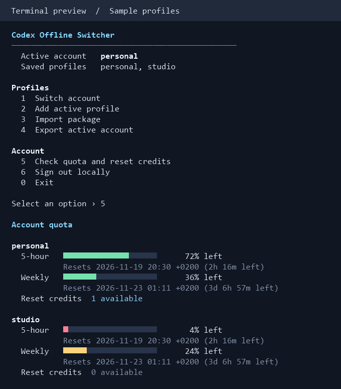

# Codex Offline Switcher

A terminal tool for managing saved Codex accounts. It copies the file-backed authentication from `CODEX_HOME` (default `~/.codex`) into named profiles. Switching preserves the existing Codex configuration, skills, history and sessions.



## Run

Requires Python 3.11 or newer. Installations that store credentials in the OS keyring are outside the supported workflow.

On Windows, run:

```powershell
py -3 codex_accounts.py
```

On macOS and Linux, run:

```sh
python3 codex_accounts.py
```

Choose **Save this computer's active account** to copy the current Codex login into a named profile. Choose **Import a profile from an export folder** when you already have a portable package. The menu also switches profiles, exports the active account, checks quotas and signs out locally.

Save your work before switching or signing out. The tool closes recognized Codex and VS Code processes before replacing or removing the local credential. If processes remain open, close them manually and retry.

In an interactive terminal, the menu redraws in place as operations progress. Choose **1** to switch by profile number and **7** to remove a profile by number. Removal archives the saved copies under the app's local data directory and leaves the current Codex login in place.

Choose **5** to show quota results directly below the menu. Type a displayed shortcut such as **S1** to switch to that profile. In **8 — Settings**, choose **Separate quota screen** if you prefer pages. On that screen, enter a profile number to switch, press Enter to return, or use N and P to browse more pages.

## Transfer a profile

The import and export menu options use the Windows folder dialog through PowerShell, the macOS folder dialog through `osascript`, or `kdialog`/`zenity` on a Linux desktop. Import selects an existing package folder. Export creates a new package folder under the selected destination. If a desktop picker is unavailable, enter the path at the terminal prompt.

**Use each Codex account on only one computer at a time with this tool.** Close Codex on the source computer before using the transferred profile on the destination. The tool copies the sign-in credentials, and concurrent use can cause token refresh conflicts.

Use **Export this computer's active account** on the source machine, copy the resulting folder privately to the destination, and use **Import a profile from an export folder** there. Each export contains `auth.json`, `SHA256.txt` and `manifest.txt`. Treat the export folder like a password and keep it out of Git.

Profile management is local. **Check quota and reset credits** makes an authenticated read to ChatGPT and reports the five-hour and weekly limits, the reset countdown, and any available reset credits. It uses the existing access token.

The terminal and live quota check have been exercised on Windows. Account changes were tested with dummy credentials on Windows. Native macOS and Linux runs are unverified.
